# nijigen-svg-skills

AI生成イラスト（二次元絵）を、編集可能なSVGへ変換するためのエージェントスキル集。

## 考え方

変換は3つの工程の連鎖であり、各工程が担える正確さは異なる：

- **意味の判断**（何を残し、何を捨てるか）は画像モデルの仕事
- **機械的な変換**（輪郭のパス化）はトレーサの仕事
- **数値の正確さ**（色値、小さい必須パーツ、文字列）はコードの仕事

この分業を軸に、次の概念で運用する（詳細は SKILL.md）：

1. **再生成の性質**：モデルは編集ではなく様式カテゴリからの再生成を行う。
   無指定の性質は様式の標準形で埋まるため、保持したい性質は測定できる
   単位で漏れなく固定する。様式はカテゴリとして切り替わるので、抽象度の
   選択は様式の選択でもある。
2. **情報チャネル**：本人性は輪郭・内部線・階調・色・文字という別々の
   チャネルに宿り、チャネルを消せばそこに符号化された情報も消える。
   文字は記号列なので、パス化せずテキストとして持つ。
3. **コスト構造**：SVGの総量は「要素数 × 要素あたりの境界の複雑さ」。
   簡略化が効くのは内部の複雑さが支配項のときだけであり、部位ごとに
   予算を配分して総量を制御する。
4. **下流の閾値**：トレーサは近い色を統合し小さい領域を捨てる。残すものは
   閾値より大きく描き、色は隣接部位との関係で分離させる。
5. **最終形での検証**：合格は変換をまたいで持ち越せない。各工程の出力を、
   実際にレンダリングした形で目視し、数値で計測して判定する。
6. **目標の塗りの文法**：線が境界を決め、影は階調の数ではなく形で
   情報を運び（既定は影1色）、分離は配色の明度差で担保する。この文法で
   描かれた絵は直接トレースが最適になり、描き直しの目標もこの文法への
   変換として定義できる。

工程は「分解 → 描き直し（生成）→ トレース（機械）→ 検証 →
コード側調整」。エージェント自身は描かず、分解・配分・指示・計測・
判定を担う。

## Before / After

左が元絵、右が最終形SVGのレンダリング。数値はパス数 / サイズ。

**slopなAI絵 → 描き直し＋トレース**（503パス/801KB → 104パス/167KB）

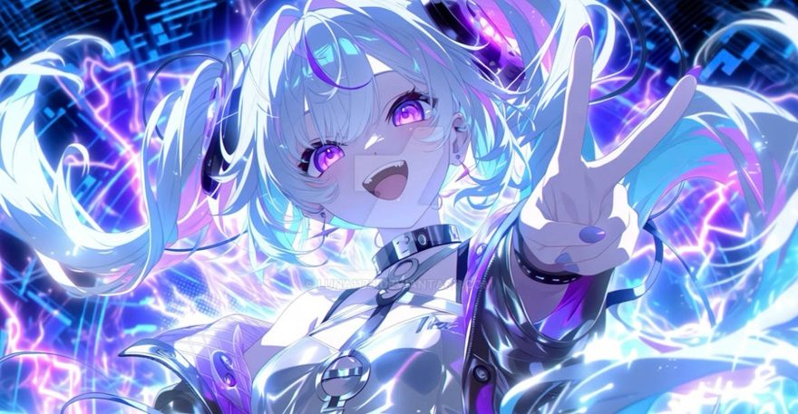
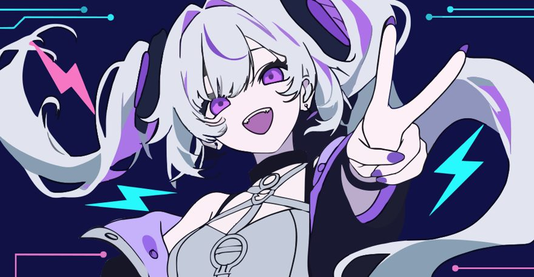

**境界を線で明示した描き直し**（横顔の鼻が線として残り、復旧ゼロで
302パス/330KB。明示しない版は復旧込みで約1,200パス/917KB）

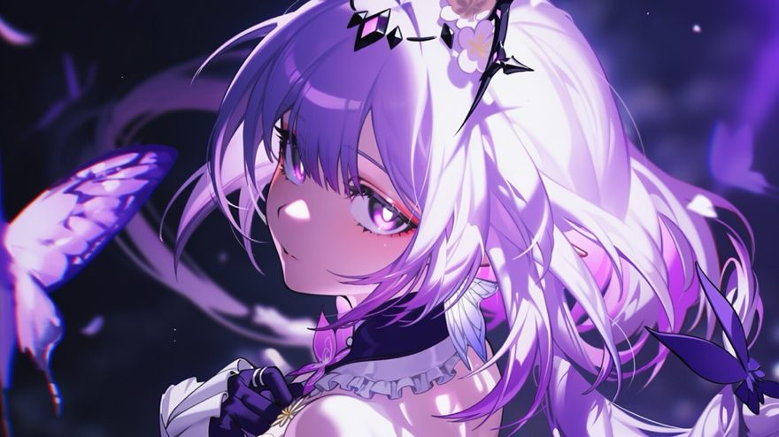
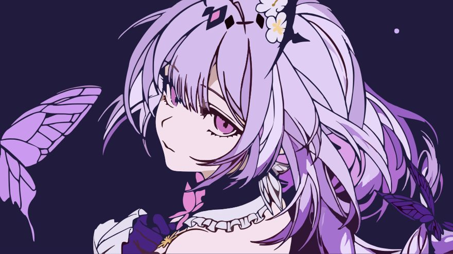

**実写写真 → ベクター似顔絵**（色距離が際どく固定設定では崩壊する
ため、厳しい設定で再トレースして252パス/224KB）

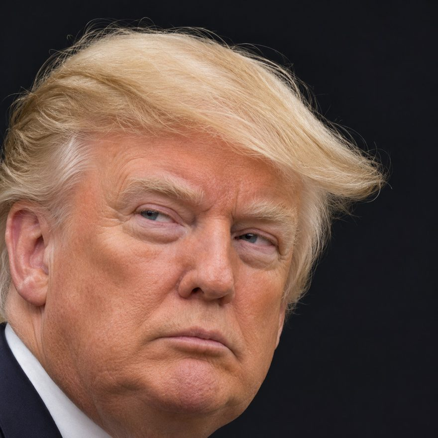
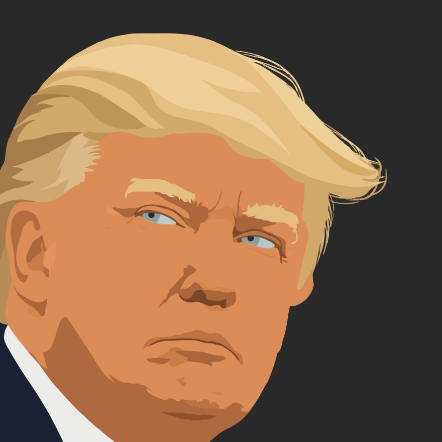

**文法で描かれた絵は描き直し不要**（直接トレース189パス/219KB、
全パーツ生存）

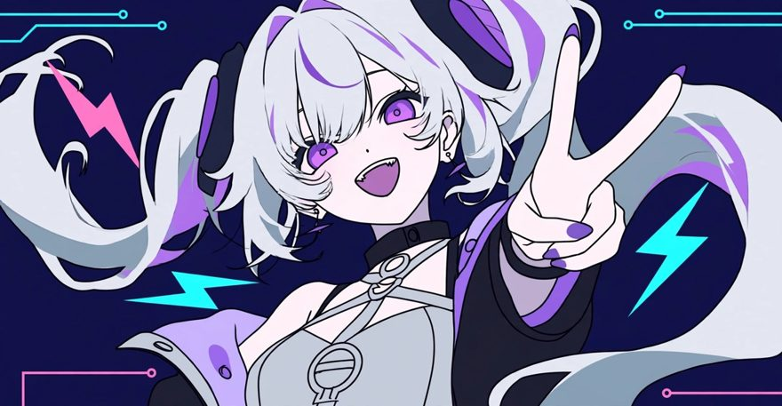
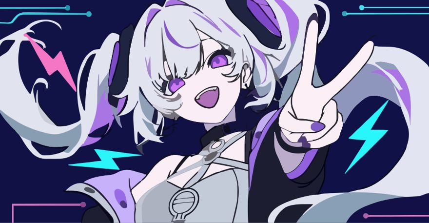

**古典セル画も直接トレース**（92パス。ただし同色レイヤーの氾濫だけ
コード側で補修）

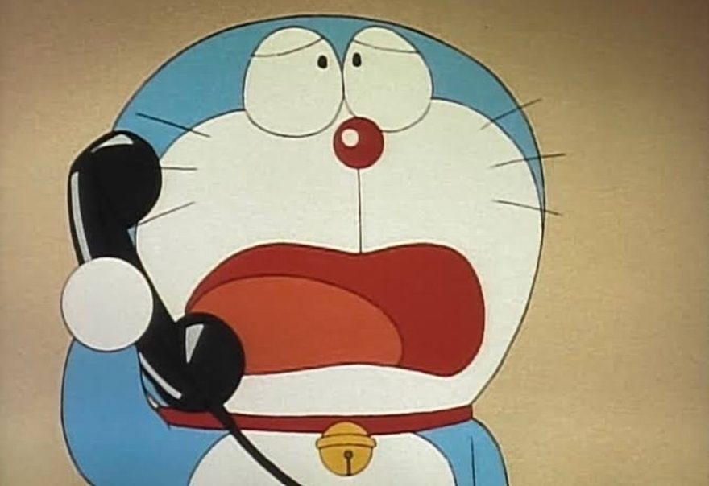
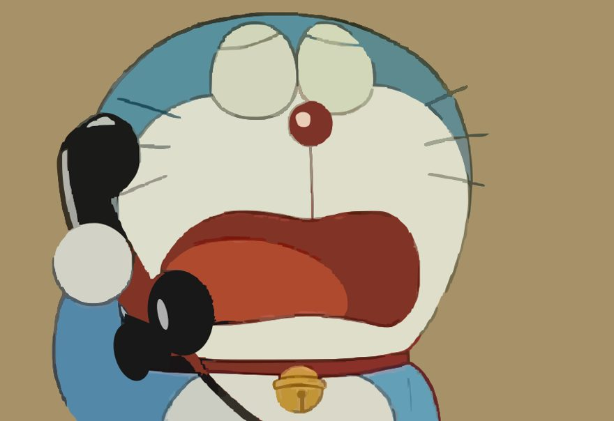

**PNG納品＋陰影の後付け＋背景削除（デフォルト）**（フラットで構造を
確定させてから陰影だけを別パスで足し、最後に背景を抜いて透過で納品）

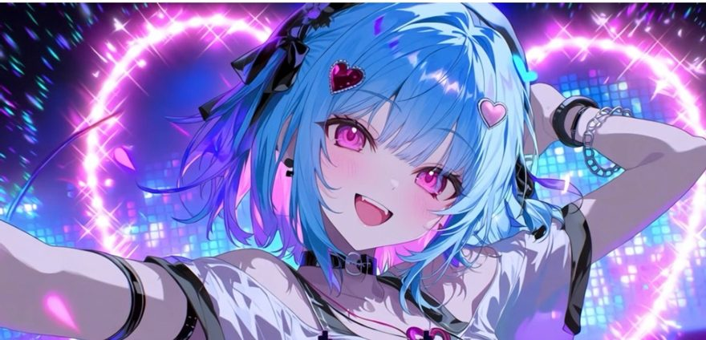
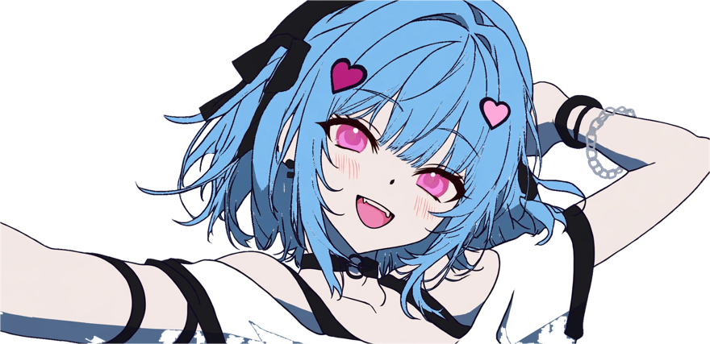

## 実測データ（2026-11-27、VTracer同一設定）

概念の裏付けとなった測定値。対象の選定ではなく記録として残す。

| 対象 | 直接トレース | 描き直し後にトレース |
|---|---|---|
| アイコン絵（灰髪・渦巻き目） | 376パス / 819KB | **104パス / 167KB** |
| 横長の複雑な絵（ツインテール・ピース手） | 503パス / 801KB | **221パス / 300KB** |
| 円形アバター（銀髪・青目） | 241パス / 360KB | **84パス / 192KB** |
| 紫髪と蝶 | 285パス / 410KB | **103パス / 191KB** |
| 要素過密な画面（人物・玉・ロゴ群） | 482パス / 768KB | 468パス / 571KB（要素数が支配項） |
| 透明感が主題の絵（階調なし） | 134パス / 151KB | 68パス（情報は記号化でしか残らない） |
| 透明感が主題の絵（階調を予算化） | 134パス / 151KB | 177パス / 262KB |
| 抽象化済みの絵 | 154パス / 279KB | 125パス / 159KB（清書として作用） |
| 抽象度・強 | 162パス / 305KB | 65パス / 100KB（様式が切り替わり本人性が低下） |
| 抽象度・弱 | 162パス / 305KB | 412パス / 741KB（内部複雑さが残り逆転） |
| 抽象度・中＋目の予算指定 | 469パス / 928KB | 299パス / 524KB |
| 目だけ高予算＋コード側調整 | 241パス / 360KB | 120パス / 222KB |
| 低解像度・元々フラットな絵 | 31パス / 30KB | 65パス / 81KB（逆転：成果は解像度と編集可能性） |
| 発光＋暗色＋低解像度 | 161パス / 204KB | 213パス / 262KB（閾値を緩めると逆転） |
| 階調を全て外した版 | 161パス / 204KB | 41パス / 80KB（様式がマスコットへ切替） |
| 4コマ漫画（文字は活字で保持） | 703パス / 1,011KB | 331パス（絵のみ）＋ `<text>`、計398KB |
| 文法で描かれた絵（線＋影1色） | —（描き直し不要） | 直接トレース 189パス / 219KB で全パーツ生存 |
| 文法のみ指定（予算なし）で描き直し | 469パス / 928KB | 475パス / 804KB（文法と予算は別軸） |
| エンジンのみ（平滑化＋量子化＋統合） | — | Luna 145/130KB、アイコン 169/282KB、泡 189/305KB、サイバー 352/415KB（様式は滑らないが小パーツと意味境界で生成に劣る） |
| 初期型の単純さ＋保持指定（軽さ優先） | 469パス / 928KB | **161パス / 271KB**（同題材で最軽量） |
| 強い参照を丸ごと真似＋キー色背景（質優先） | 469パス / 928KB | 265パス / 465KB（顔の文法まで移るが描き込みが戻る） |
| キー色背景で分離 | — | 背景が1つの色族として独立し、キーアウト合成で縁のフリンジなし |
| 境界を線で明示した描き直し（横顔） | 285パス / 410KB | **302パス / 330KB**（復旧ゼロ。明示しない版は復旧込みで約1,200パス/917KB） |
| 実写写真（暖色の近接色） | 183パス / 317KB | 252パス / 224KB（固定設定では42パスに崩壊、厳しい設定で再トレース） |
| 古典セル画（直接トレース） | — | 92パス / 205KB（同色レイヤーの氾濫のみ補修） |

## スキル一覧

- [`ai-image-to-svg`](ai-image-to-svg/SKILL.md) — AI絵→SVG変換の全工程
  （概念、分解、描き直しプロンプト、トレーススクリプト、検証ゲート、
  コード側調整）

## ライセンス

MIT License
